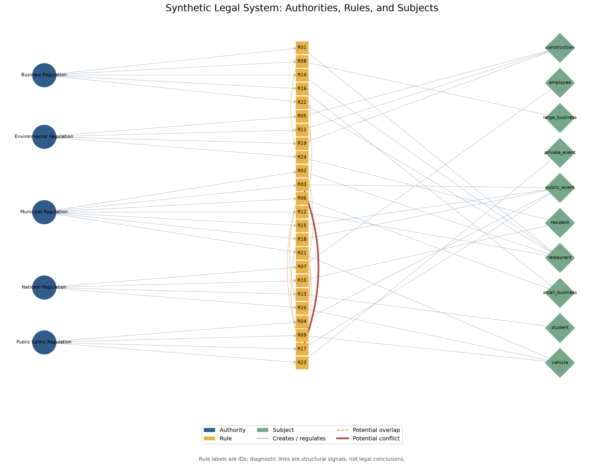
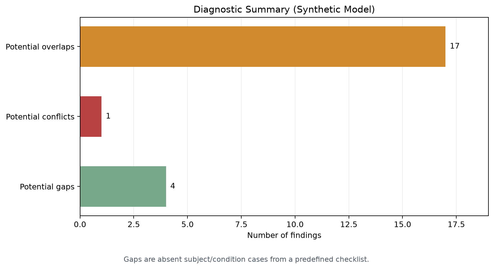
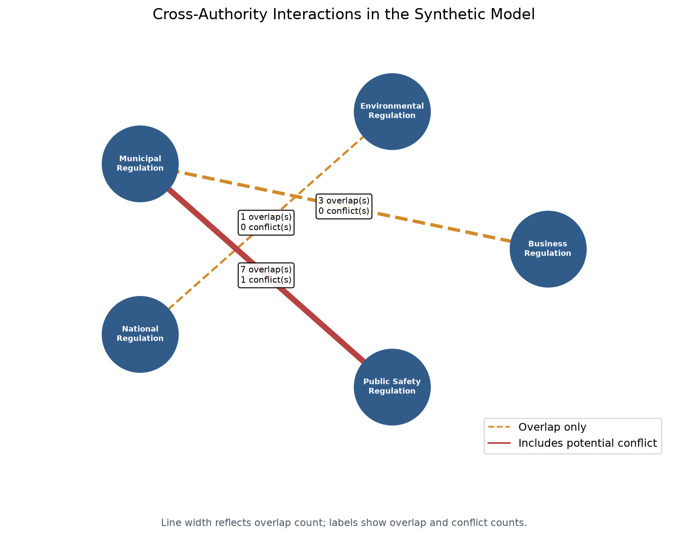

# Computational Legal Diagnostics Explorer

A small, research-oriented Python demonstration inspired by **“Computational
Legal Diagnostics and the Limits of Human Legal Reasoning.”** It explores how a
structured representation can help a researcher inspect relationships among
synthetic norms.

> **This is not legal advice or a legal decision system.** The dataset is
> synthetic, and diagnostic findings are prompts for human review—not legal
> conclusions.

## Research motivation

Legal reasoning interprets norms in context. A computational system can
systematically compare a structured representation, highlight patterns, and
help a researcher decide where to look more closely. It cannot replace the
human interpretation and judgment needed to determine what a real rule means
or how it applies.

The intended workflow is:

```text
Computational detection
        ↓
Potential anomaly
        ↓
Human legal review
        ↓
Interpretation and judgment
```

The project makes no empirical or doctrinal claims about the named paper. It is
a prototype demonstrating a computational methodology.

## Conceptual model

The system represents three kinds of entities and their connections:

```text
Authorities → Rules → Subjects
                 ↔
          diagnostic links
```

An authority creates a rule; a rule regulates a subject; rules may be linked
when the simplified comparison identifies a potential overlap or conflict.
Each rule contains an ID, authority, subject, condition, action, and scope.

## Rule representation

Rules are stored in [`data/synthetic_rules.json`](data/synthetic_rules.json).
For example:

```json
{
  "id": "R01",
  "authority": "Business Regulation",
  "subject": "restaurant",
  "condition": "registered",
  "action": "permit",
  "scope": "local"
}
```

The dataset contains 24 synthetic rules and a predefined checklist of subject
and condition combinations used for the gap demonstration.

## Diagnostics

- **Potential overlap:** two rules share the same subject and exact condition.
  An overlap is not automatically inconsistent. Scope is recorded but not
  interpreted by the current comparison.
- **Potential conflict:** an overlapping pair has actions from the explicitly
  modeled incompatible pair `permit` and `prohibit`. Other action pairs are not
  classified as conflicts by this prototype.
- **Potential gap:** a predefined subject/condition case has no matching rule
  in this dataset. This is only a gap in the modeled checklist.
- **Authority interaction:** summarizes cross-authority rule pairs, counting
  overlaps and potential conflicts.

The engine validates required text fields, unique rule IDs, supported actions
and scopes, and duplicate checklist cases before running diagnostics.

## Graph representation

NetworkX builds a directed multigraph with authority, rule, and subject nodes.
Edges represent `creates`, `regulates`, `overlaps`, and
`potentially_conflicts_with`. The graph preserves overlaps and conflicts as
separate relation types. Matplotlib generates:

### Legal system graph



### Diagnostic summary



### Authority interactions



## Results

The current synthetic dataset produces 17 potential overlaps, one potential
conflict, and four potential gaps. `public_event` and `restaurant` are the most
represented subjects (five rules each). Municipal Regulation and Public Safety
Regulation share the most cross-authority rule pairs in this dataset.

These counts depend on the synthetic data and the exact comparison rules; they
are not measurements of any real legal system.

## Human reasoning and limitations

Identical subjects do not necessarily imply legal conflict. Apparent
contradictions may be resolved by hierarchy, jurisdiction, exceptions,
definitions, or temporal scope. A missing modeled rule does not establish a
real regulatory gap. This prototype does not capture those contextual
interpretive tasks.

Limitations include:

- synthetic data only;
- simplified, exact-match conditions and subjects;
- no natural-language interpretation;
- no legal hierarchy or jurisdictional reasoning;
- no temporal validity, exceptions, or case-law relationships;
- action compatibility is deliberately narrow; and
- no legal advice or real-world legal conclusions.

## Future work

Possible extensions include modeling jurisdiction and legal hierarchy,
temporal validity and exceptions, richer human-authored rule relationships,
larger reviewed datasets, and a human-in-the-loop review interface. Any
extension should preserve the distinction between a diagnostic signal and a
legal conclusion.

## Reproducibility

Requires Python 3.10 or later.

```bash
pip install -r requirements.txt
python main.py
```

The script validates the dataset, runs the diagnostics, prints a console
report, and writes the visualizations to `results/`.

Run the lightweight test suite with:

```bash
python -m unittest discover -s tests -v
```
